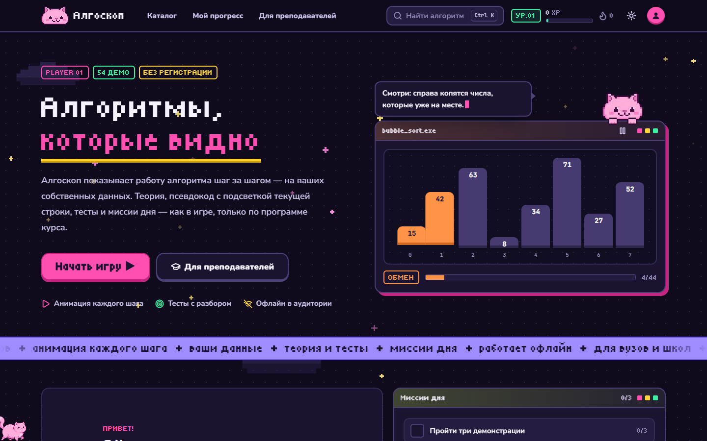
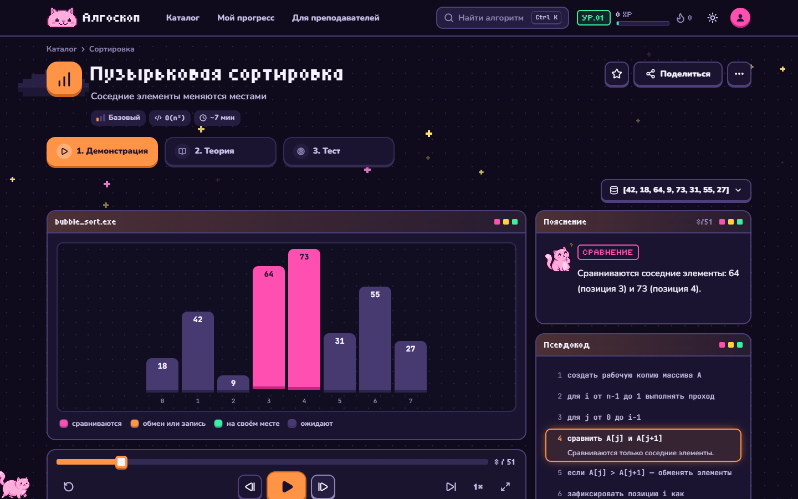
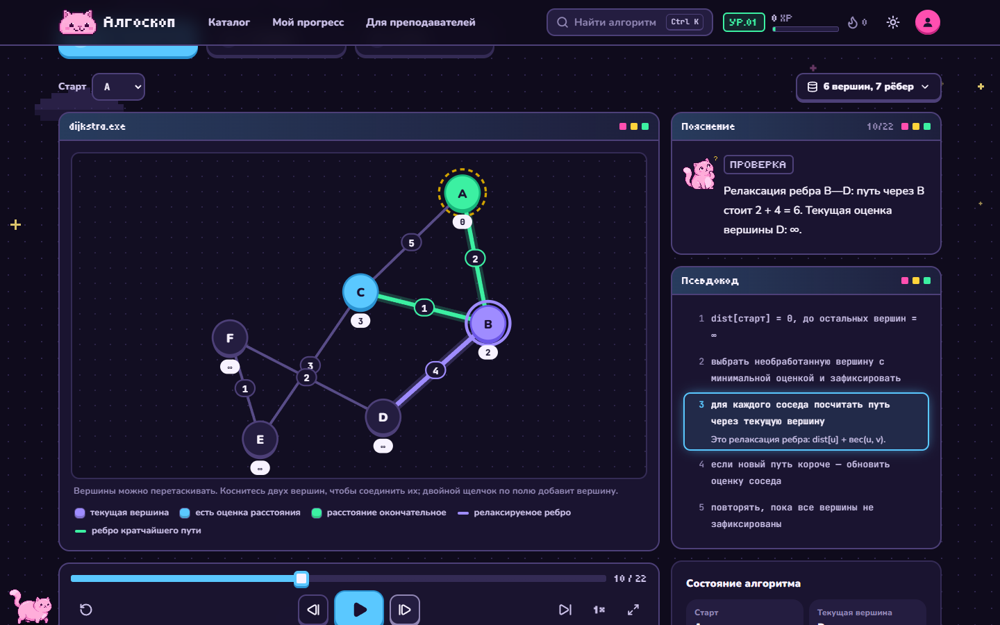
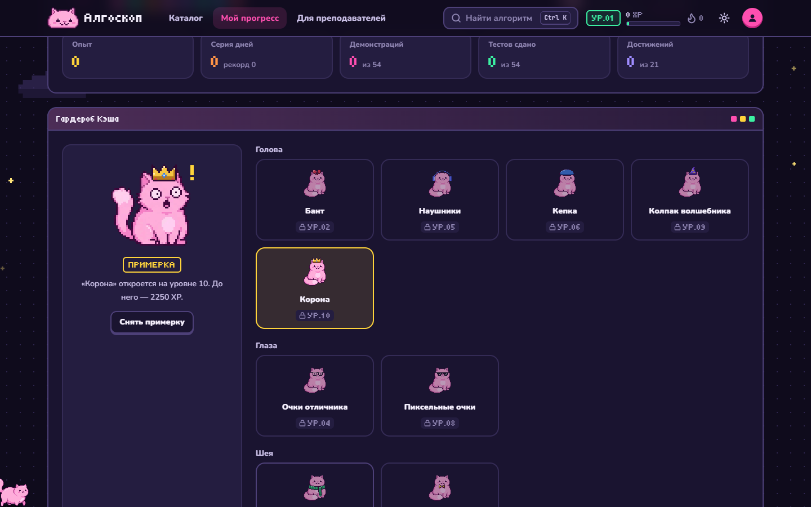
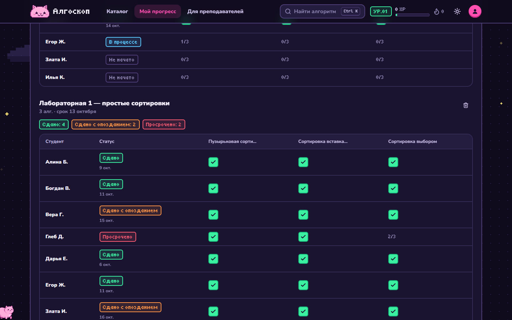
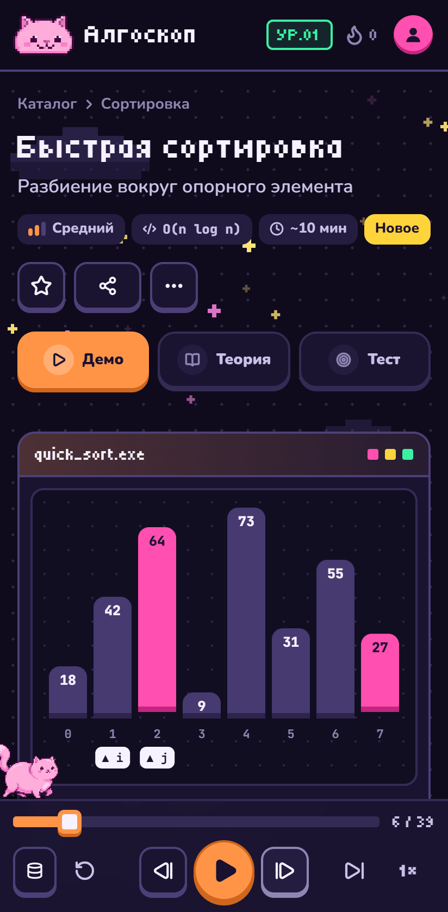

# Алгоскоп

[](https://github.com/mmywq/algorithm-visualizer/actions/workflows/ci.yml)

**Сайт:** https://algorithm-visualizer-rust-iota.vercel.app

Интерактивный тренажёр по алгоритмам и структурам данных. Каждый алгоритм показан пошаговой анимацией на данных пользователя. К каждому есть теория, псевдокод с подсветкой текущей строки и тест. Для учебных заведений — классы, задания и сводка прогресса группы.



## Возможности

- **54 алгоритма в 9 разделах**: линейные структуры, поиск, сортировки, хеш-таблицы, деревья, кучи и множества, графы, динамическое программирование, строки.
- **Демонстрации**: свои входные данные, проигрывание по шагам и с любой скорости, пояснение каждого шага, итог с разбором. Режим лекции на весь экран (клавиша `F`) и код для встраивания в Moodle, Stepik и другие системы.
- **Теория и тесты**: по пять вопросов к каждому алгоритму с разбором ответа. Тест засчитывается при 70% верных ответов.
- **Личный кабинет**: опыт и уровни, достижения, миссии дня, серия дней, календарь активности, сохранённые наборы данных, резервная копия в файл.
- **Маскот Кэш** гуляет по экрану и реагирует на успехи. За уровни 2–10 открываются вещи гардероба. Учебные материалы не закрываются никогда.
- **Для преподавателей**: классы с кодом для вступления, задания со сроками, статусы сдачи (в срок, с опозданием, просрочено), выгрузка сводки в Excel. Панель можно посмотреть без облака в демо-классе с вымышленными студентами: `/cabinet/classes/demo`.
- Тёмная и светлая темы, мобильная вёрстка, работа офлайн (PWA).

| Сортировка по шагам                                                       | Алгоритм Дейкстры                                                   |
| ------------------------------------------------------------------------- | ------------------------------------------------------------------- |
|  |  |
| **Гардероб Кэша**                                                         | **Класс преподавателя**                                             |
|                         |       |

<p align="center"></p>

## Как это устроено

- **Алгоритм — чистый генератор кадров.** Каждый алгоритм написан как `function*`, который отдаёт кадры: состояние структуры, строку псевдокода и пояснение. Интерфейс только проигрывает кадры вперёд и назад, поэтому логику алгоритма можно тестировать отдельно от экрана.
- **Пиксельный маскот без картинок.** Позы Кэша хранятся как матрицы символов с палитрой. На canvas они превращаются в PNG, результат кешируется и масштабируется только в целое число раз, поэтому пиксели остаются чёткими. Вещи гардероба — отдельные слои, подогнанные под каждую позу. Ходьба собрана из четырёх кадров: лапы наклоняются от бедра.
- **Данные пользователя** хранятся в zustand с сохранением в браузере и миграциями версий. При входе в облако локальная и облачная копии сливаются, ничего не теряется.
- **Единая система движения.** Все переходы построены на нескольких общих пружинах и кривых (`src/lib/motion.ts`), поэтому сайт двигается одинаково везде. Блоки проявляются из лёгкого размытия, частые действия (шаги демонстрации, переключатели) — короткие и без отскока, отскок оставлен только для праздничных моментов. Фон живой, но экономный: звёзды мерцают вразнобой, комета каждый раз летит новым путём, бегущая строка откликается на прокрутку и стоит, когда её не видно. Анимируются только `transform`, `opacity` и `clip-path`. Настройка «меньше движения» выключает все переходы, а демо на главной можно поставить на паузу.
- **Лёгкая загрузка.** Страницы, демонстрации, теория и тесты по разделам грузятся отдельными частями. Стартовая загрузка — около 190 КБ в gzip.
- **Безопасность облака.** Все таблицы закрыты политиками RLS, а операции с чужими данными идут через серверные функции с проверкой прав. Размер записей ограничен; при выгрузке в Excel формулы в именах студентов обезвреживаются.
- **Доступность.** Семантическая разметка (радиокнопки в тестах, подписи, списки), управление проигрывателем с клавиатуры, настройка «меньше движения». Десять основных страниц автоматически проверяются axe-core по WCAG 2.1 AA.

## Быстрый старт

Нужен Node.js 22 или новее.

```bash
npm ci
npm run dev
```

Сайт откроется на http://localhost:5173. Без настроек он работает в локальном режиме: весь прогресс хранится в браузере, аккаунты и классы отключены.

| Команда                           | Что делает                                |
| --------------------------------- | ----------------------------------------- |
| `npm run dev`                     | сервер разработки                         |
| `npm test`                        | тесты алгоритмов и содержимого каталога   |
| `npm run test:e2e`                | сборка и сквозные тесты в браузере        |
| `npm run typecheck`               | проверка типов                            |
| `npm run format` / `format:check` | форматирование Prettier / проверка        |
| `npm run build`                   | сборка в `dist/`                          |
| `npm run preview`                 | просмотр собранной версии                 |
| `npm run screenshots`             | скриншоты для README в `docs/screenshots` |

Все проверки запускаются в GitHub Actions на каждый push и pull request (`.github/workflows/ci.yml`).

## Тесты

- **Модульные** (Vitest, `src/**/*.test.ts`): корректность каждого алгоритма — кадры демонстрации заканчиваются правильным ответом и сверяются с простой эталонной реализацией. Отдельно проверяются содержимое каталога (у каждого алгоритма есть теория, демонстрация и не меньше пяти корректных вопросов теста), статусы заданий, выгрузка в CSV и склонение слов после чисел.
- **Сквозные** (Playwright, `e2e/`): реальные сценарии на собранном сайте. Свои данные в демонстрации, прохождение теста и опыт в кабинете, статусы и выгрузка в демо-классе, баннер cookie, страница 404, отсутствие горизонтальной прокрутки на телефоне.
- **Доступность** (axe-core в Playwright): десять основных страниц проверяются по WCAG 2.1 A и AA. Тест падает на нарушениях уровней serious и critical.

Сквозные тесты идут в трёх профилях: Chromium на десктопе, Chromium в эмуляции Pixel 7 и WebKit (движок Safari) в эмуляции iPhone 14. Локально вместо скачанного Chromium можно взять установленный браузер:

```bash
PW_CHANNEL=msedge npm run test:e2e
```

WebKit локально включается переменной `PW_WEBKIT=1`; в CI он запускается всегда.

## Переменные окружения

Скопируйте `.env.example` в `.env`. Все переменные необязательны.

| Переменная                                    | Назначение                                                                                           |
| --------------------------------------------- | ---------------------------------------------------------------------------------------------------- |
| `VITE_SITE_URL`                               | адрес сайта без слеша в конце; нужен для `sitemap.xml`, канонических ссылок и ссылок в письмах входа |
| `VITE_SUPABASE_URL`, `VITE_SUPABASE_ANON_KEY` | включают облачный режим: аккаунты, синхронизацию, классы, приём заявок                               |
| `VITE_AUTH_PROVIDERS`                         | вход через внешние сервисы: `google`, `github` через запятую                                         |
| `VITE_CONTACT_EMAIL`                          | контактная почта в документах; без облака заявки уходят письмом на неё                               |
| `VITE_LEGAL_ENTITY`                           | оператор персональных данных и правообладатель для политики и условий                                |

Переменные `VITE_*` попадают в код страницы и видны всем. Ключ `service_role` из Supabase сюда класть нельзя.

## Облачный режим (Supabase)

1. Создайте проект в [Supabase](https://supabase.com) или разверните Supabase на своём сервере (см. раздел о персональных данных).
2. Примените схему базы из `supabase/migrations/`. Можно через CLI:

   ```bash
   supabase link --project-ref <ref-проекта>
   ```

   ```bash
   supabase db push
   ```

   Или вставьте файл миграции целиком в SQL Editor.

3. В **Authentication → URL Configuration** укажите Site URL (то же, что `VITE_SITE_URL`). В Redirect URLs добавьте `<адрес сайта>/auth/callback`, а для разработки — `http://localhost:5173/auth/callback`.
4. Для входа через Google или GitHub включите провайдеров в **Authentication → Providers** и перечислите их в `VITE_AUTH_PROVIDERS`.
5. Заполните `VITE_SUPABASE_URL` и `VITE_SUPABASE_ANON_KEY` (**Settings → API**) и пересоберите сайт.

Что создаёт миграция:

- `profiles`: имя и роль пользователя;
- `user_data`: облачная копия прогресса, один JSON на пользователя, не больше 1 МБ;
- `classes`, `class_members`, `assignments`: классы, участники и задания;
- `license_requests`: заявки со страницы «Для учебных заведений». Читаются только из панели Supabase (Table Editor).

Все таблицы закрыты политиками RLS: каждый видит только свои данные. Преподаватель видит участников и задания своих классов, а прогресс участников получает через функцию `get_class_progress` — только раздел `progress`, без наборов данных и истории. Создание класса, вступление по коду и удаление аккаунта тоже идут через серверные функции, которые проверяют права вызывающего.

## Персональные данные

В локальном режиме сайт не собирает персональных данных: прогресс остаётся в браузере. В облачном режиме хранятся почта, имя и учебный прогресс. Тогда владелец сайта становится оператором персональных данных по 152-ФЗ.

- **Документы.** Политика конфиденциальности и условия использования формируются автоматически (`/privacy`, `/terms`) из `VITE_LEGAL_ENTITY` и `VITE_CONTACT_EMAIL`. Перед запуском их должен проверить юрист.
- **Уведомление Роскомнадзора.** До начала обработки нужно подать уведомление об обработке персональных данных.
- **Локализация.** Часть 5 статьи 18 152-ФЗ требует записывать и хранить персональные данные граждан РФ в базах данных на территории России. Облачные регионы Supabase находятся за её пределами. Для российских пользователей Supabase стоит развернуть на сервере в России (проект открытый, миграция та же) или оставить сайт в локальном режиме.
- **Удаление.** Пользователь может сам удалить аккаунт в личном кабинете (вкладка «Обзор», окно «Хранилище»). Вместе с ним удаляются облачные данные, членство в классах и созданные классы.

Этот раздел — ориентир для разработчика, а не юридическая консультация.

## Развёртывание

`npm run build` собирает статический сайт в `dist/`. Его можно разместить на любом статическом хостинге. Нужно одно правило: все неизвестные пути отдают `index.html`, потому что маршрутизация работает в браузере.

Сайт развёрнут на Vercel: настройки в `vercel.json` (все пути отдают приложение, `sw.js` не кешируется), адрес для production-сборки — в `.env.production`.

Пример для nginx:

```nginx
location / {
  try_files $uri /index.html;
}

# сервис-воркер не кешировать, иначе обновления сайта будут приходить с опозданием
location = /sw.js {
  add_header Cache-Control "no-cache";
}
```

## Устройство проекта

```
src/
  algorithms/     генераторы кадров для каждого алгоритма и их тесты
  demos/          страницы демонстраций по разделам
  content/        каталог, теория, тесты, достижения, гардероб, тексты документов
  features/       страница алгоритма, проигрыватель, вход, синхронизация
  components/     интерфейс: окна, кнопки, маскот, визуализаторы, раскладка
  pages/          главная, каталог, кабинет, классы, настройки, документы
  stores/         состояние на zustand (прогресс, настройки, согласие на cookie)
  lib/            данные пользователя, прогресс и уровни, Supabase, PWA
supabase/migrations/   схема базы для облачного режима
scripts/               плагин сборки: sitemap.xml и robots.txt
```

Стек: Vite 5, React 18, TypeScript (strict), Tailwind CSS 3, zustand, framer-motion, React Router 6, Vitest, vite-plugin-pwa, Supabase.
